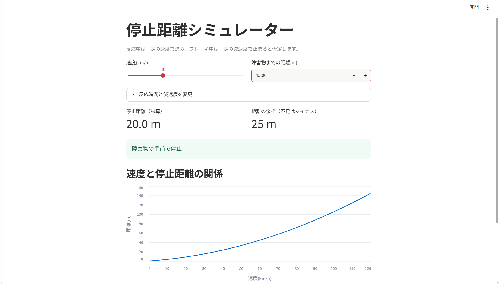

# 停止距離シミュレーター

速度・障害物までの距離・反応時間・減速度を入力して、停止距離と距離の余裕を試算するWebアプリです。PythonとStreamlitで作成しました。



## 計算と判定

停止距離は、ブレーキを踏むまでの空走距離と、踏んでから停止するまでの制動距離の合計です。反応中は一定速度、ブレーキ中は一定の減速度を仮定しています。

## 確認ケース

速度36 km/h、反応時間1秒、減速度5 m/s²のとき、停止距離は20.0 mです。

| 障害物までの距離 | 余裕 | 判定 |
|---|---:|---|
| 45 m | 25 m | 手前で停止 |
| 20 m | 0 m | 停止位置が一致 |
| 15 m | −5 m | 距離が不足 |

## 起動方法（Windows PowerShell）

```powershell
py -m venv .venv
.\.venv\Scripts\python.exe -m pip install -r requirements.txt
.\.venv\Scripts\python.exe -m streamlit run app.py
```